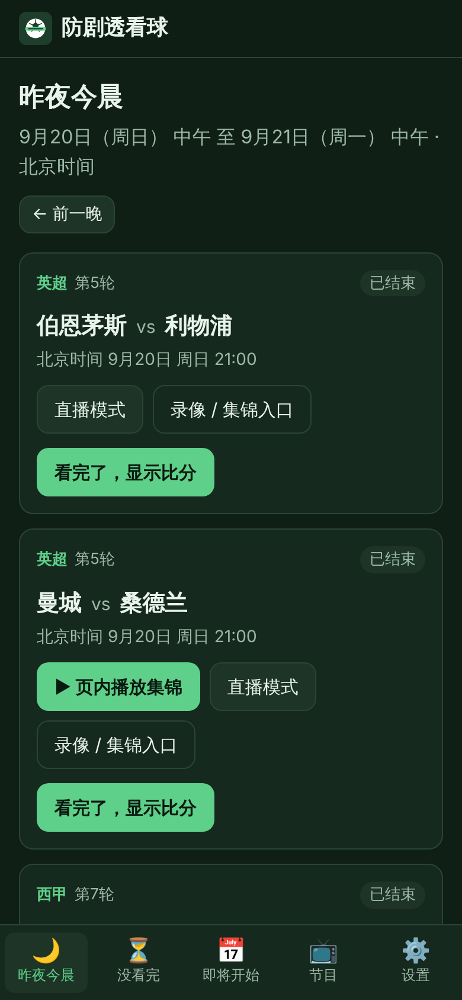
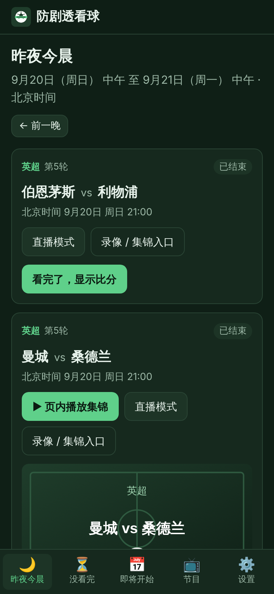
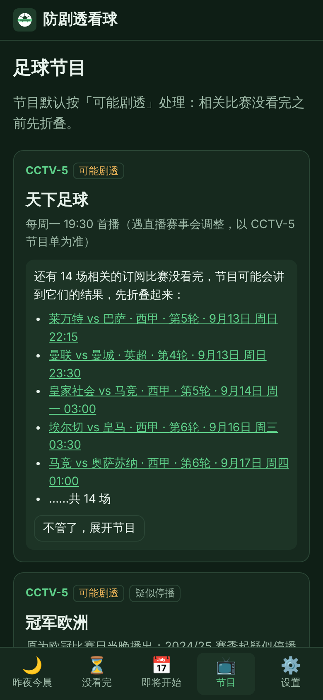
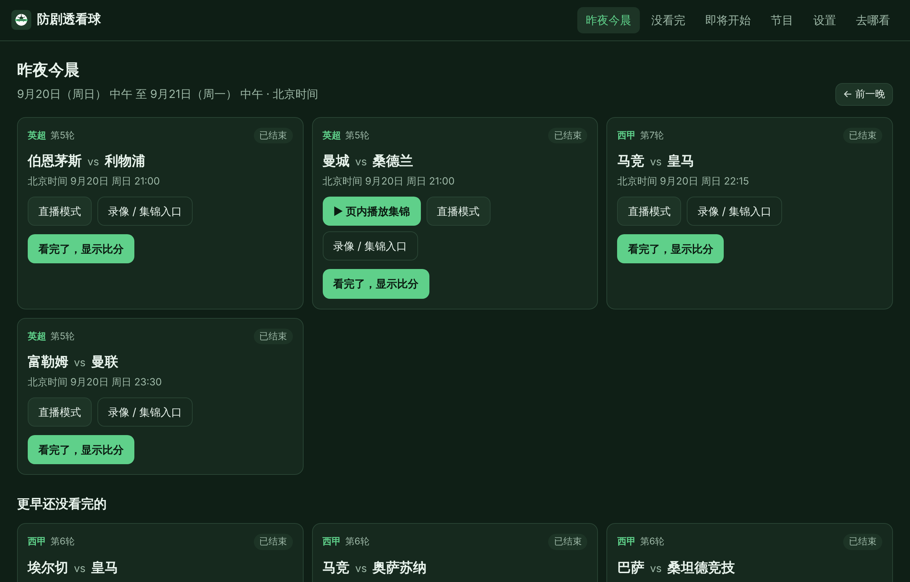

# 防剧透看球 spoiler-free-football

晚上不熬夜，早上起来看全场录像或集锦，像看直播一样不知道结果。

这个项目包括四部分，共用同一套防剧透识别逻辑：

| 部分 | 用途 | 在哪用 |
|---|---|---|
| **网页（PWA）** | 「昨夜今晨」：列出你订阅的球队昨晚到今早的比赛，标题都是中性的；直接跳转正版平台看录像/集锦；看完点「显示比分」 | 电脑、平板、手机，可以添加到主屏幕当 App 用 |
| **浏览器插件** | 在咪咕视频、央视频、CCTV、爱奇艺、腾讯视频、B站、懂球帝、直播吧、虎扑上隐藏比分、结果词、视频时长、进度条、弹幕、评论、推荐和封面 | 电脑上的 Chrome / Microsoft Edge / Firefox |
| **用户脚本** | 和插件一样的遮挡，带一个手机上好点的悬浮按钮 | Android 的 Via、X 浏览器、狐猴等；iPhone/iPad 的 Safari（Userscripts App）；电脑上的 Tampermonkey / Violentmonkey |
| **数据管线** | 每天自动汇总赛程和正版观看入口，产出**不含比分**的数据；比分单独存放，只在你点「显示比分」时才下载 | GitHub Actions 自动运行，不需要你管 |

<p>



</p>



（截图用的是项目自带的示例数据：北京时间 2026 年 9 月 21 日早上。）

---

## 目录

- [你需要做的几步（第一次）](#你需要做的几步第一次)
- [各平台安装](#各平台安装)
- [日常怎么用](#日常怎么用)
- [防剧透具体做了什么](#防剧透具体做了什么)
- [关注范围与订阅](#关注范围与订阅)
- [去哪看：正版渠道](#去哪看正版渠道)
- [足球节目](#足球节目)
- [数据来源与合规](#数据来源与合规)
- [自己改配置（不用写代码）](#自己改配置不用写代码)
- [国内访问慢怎么办](#国内访问慢怎么办)
- [可选：同步服务器](#可选同步服务器)
- [已知限制](#已知限制)
- [开发者说明](#开发者说明)

---

## 你需要做的几步（第一次）

整个过程在 GitHub 网页上点点就行，不需要装任何开发工具。

### 第 1 步：注册免费的赛程 API（推荐，5 分钟）

不注册也能用：英超、西甲赛程来自免费公开数据 openfootball，杯赛和国家队比赛来自 TheSportsDB 的公开测试 Key。
但 openfootball 的比分更新比较慢，TheSportsDB 的免费 Key 又只有当前前后几轮（欧冠等杯赛早期轮次可能不全），所以强烈建议注册 football-data.org，赛程更完整、比分更及时：

1. 打开 <https://www.football-data.org/client/register>，填邮箱注册（免费档）。
2. 邮件里会收到一串 API Token。

可选的付费数据源（不买也行）：

| 名称 | 作用 | 在哪里获取 |
|---|---|---|
| `THESPORTSDB_KEY` | TheSportsDB 付费 Key，杯赛/国家队赛程更全（免费 Key 只拉当前前后几轮） | <https://www.thesportsdb.com/pricing> |
| `APIFOOTBALL_KEY` | API-Football，作为补充来源（免费档可能不开放当前赛季） | <https://dashboard.api-football.com/register> |

### 第 2 步：把 Token 加到仓库的 Secrets

1. 打开仓库页面 → **Settings** → 左侧 **Secrets and variables** → **Actions**。
2. 点 **New repository secret**：Name 填 `FOOTBALL_DATA_TOKEN`，Secret 填第 1 步拿到的 Token，保存。
3. （可选）同样方式添加 `THESPORTSDB_KEY`、`APIFOOTBALL_KEY`。

密钥只保存在 GitHub 的 Secrets 里，代码和数据里都不会出现。

### 第 3 步：开启网页托管

**方式 A：GitHub Pages（默认）**

1. 公开仓库一般**不用手动开**：第 4 步第一次运行时，工作流会自动把 GitHub Pages 打开（来源设为 GitHub Actions）。如果运行页面上仍提示「网页还没上线」，再手动开：仓库 **Settings** → **Pages** → **Build and deployment** 里的 Source 选 **GitHub Actions**。
2. 注意：**私有仓库开 Pages 需要 GitHub Pro / Team 等付费套餐**（自动开启也会失败）。如果 Pages 页面提示需要升级，有两个选择：
   - 把仓库改成公开（Settings → General → 最下面 Change visibility）。仓库里没有任何个人信息或密钥，数据也不含比分；或者
   - 用下面的方式 B。

**方式 B：Cloudflare Pages（免费，私有仓库也能用）**

Pages 项目不用自己建，网页地址也不用自己填：第一次运行时工作流会自动创建名为 `spoiler-free-football` 的项目，并把网页地址写在运行页面的小结里。你只需要做下面 3 件事：

1. **注册并找到 Account ID**：注册 <https://dash.cloudflare.com/sign-up>（免费，验证邮箱即可）。登录后看浏览器地址栏，`dash.cloudflare.com/` 后面那一串 32 位的字母和数字就是 **Account ID**。也可以在首页账户名旁边的「⋯」菜单里点 Copy account ID。
2. **创建 API Token**：右上角头像 → **My Profile** → **API Tokens** → **Create Token** → 最下面 **Create Custom Token** 的 **Get started**：
   - Token name：随便填，例如 `spoiler-free-football`
   - Permissions：三个下拉框依次选 **Account** → **Cloudflare Pages** → **Edit**
   - Account Resources：**Include** → 你的账户
   - 点 **Continue to summary** → **Create Token**，复制显示出来的 Token（只显示一次，丢了就再建一个）
3. **填进 GitHub**：仓库 **Settings → Secrets and variables → Actions**：
   - **Secrets** 标签 → New repository secret，添加 `CLOUDFLARE_API_TOKEN`（第 2 步的 Token）和 `CLOUDFLARE_ACCOUNT_ID`（第 1 步的 Account ID）
   - **Variables** 标签 → New repository variable，添加 `DEPLOY_TARGET`，值填 `cloudflare`

> 私有仓库每月有 2000 分钟免费的 Actions 额度。私有仓库里每天更新 3 次（公开仓库 5 次），大约用 300–800 分钟（第一次和缓存过期时慢，之后有缓存会快很多），再加上每次推送代码时的测试，一般够用。仓库改成公开就不限量。

然后做第 4 步。网页地址一般是 `https://spoiler-free-football.pages.dev/`（这个名字被别人用过时 Cloudflare 会自动加后缀，以运行小结里写的为准）。填错时运行会在几秒内失败，页面最上面有中文说明哪一项不对。

> 国内访问：`*.pages.dev` 和 `*.github.io` 一样，在国内可能慢或偶尔打不开（见下文「国内访问慢怎么办」）。网页打开过一次就会缓存在手机/电脑上。

### 第 4 步：第一次运行

1. 仓库 → **Actions** → 左侧选 **数据更新与部署** → 右侧 **Run workflow**。
2. 大约 5–10 分钟后完成。之后它会每天自动运行 5 次（北京时间 06:20、08:20、10:20、14:20、20:20；私有仓库只跑其中 06:20、08:20、20:20 三次；GitHub 的定时任务经常晚几十分钟到几小时才开始）。
   - 运行页面最下面有一份「数据管线结果」小结：每个数据源拿到多少场（⚠️ 表示有请求失败或一场都没拿到）、哪些球队名还没有中文名。小结里没有比分，淘汰赛的队名也会隐藏，不会暴露谁晋级。
   - 如果 GitHub Pages 还没开启，这次运行会出现红叉「网页还没上线」，并写明要去哪里设置；数据管线本身照样会试跑。在开启之前，每天的定时运行会自动跳过，不占用 Actions 额度。
3. 打开网页：GitHub Pages 是 `https://messixpro.github.io/spoiler-free-football/`（方式 B 见上）。

> GitHub 会自动停用**公开仓库**里 60 天没有任何活动的定时任务。这个工作流每天会自己续期一次，正常不用管；万一「昨夜今晨」好几天没有新比赛，打开仓库 **Actions** → 左侧 **数据更新与部署**，如果上方提示工作流已停用，点 **Enable workflow**，再点 **Run workflow** 运行一次。

### 第 5 步：装插件或脚本

看下一节。装好后打开一次网页，插件/脚本会自动记住网页地址，以后比分和规则都从那里下载。

---

## 各平台安装

插件 zip 和用户脚本在网页部署好之后可以直接下载（网页「设置 → 安装插件/脚本」里有链接）：

- 插件（Chrome / Edge）：`<网页地址>/downloads/spoiler-free-football-chrome.zip`
- 插件（Firefox）：`<网页地址>/downloads/spoiler-free-football-firefox.zip`
- 用户脚本：`<网页地址>/userscript/spoiler-free-football.user.js`
- 用户脚本（全网版）：`<网页地址>/userscript/spoiler-free-football-global.user.js`

> **0.1.0 版（2026 年 10 月 21 日之前装的）需要更新一次**：比分文件改了名字（文件名里不再有队名），旧版插件点「显示比分」会一直提示还没有比分。插件按下面「以后更新」的方法换成新的 zip；用户脚本会自动更新到 0.2.0（脚本管理器一般一天检查一次，也可以在管理器里点「检查更新」）。网页不用管，下次打开自动是新版。

全网版装好后默认就开启「全网防剧透」：每天 06:00–12:00 对所有网站做通用的比分/结果词识别（防剧透网页本身除外）。改时段：在脚本管理器的菜单里选「防剧透：设置全网时段」（`00:00-00:00` 表示全天），或者在时段内点页面右下角的「防」按钮修改；不想要了就在菜单里选「防剧透：关闭全网模式」。

也可以在仓库的 **Actions → CI → 最近一次运行 → Artifacts** 里下载 `extension-and-userscript`。

### 电脑：Chrome / Microsoft Edge

1. 下载并**解压** `spoiler-free-football-chrome.zip`，放在一个不会删的文件夹里。
2. Chrome 地址栏输入 `chrome://extensions`（Edge 输入 `edge://extensions`）。
3. 打开右上角（Edge 在左下角）的 **开发者模式**。
4. 点 **加载已解压的扩展程序**，选刚才解压出来的文件夹（里面有 `manifest.json`）。
5. 点浏览器工具栏的拼图图标，把「防剧透看球」固定出来。点它可以看到当前网站的遮挡情况、一键临时显示 5 分钟、在此站点停用，以及「看完了，显示比分」。
6. 想在新闻网站、微博等**所有网站**也防剧透：插件图标右键 → 选项 → 打开「全网防剧透」，设定时段（例如早上 06:00–12:00），浏览器会请你授权。防剧透网页本身不受全网模式影响，在网页上点「看完了，显示比分」照常能看到比分。

> 以后更新：用新的 zip 覆盖文件夹，再在扩展页面点一下刷新按钮。上架 Chrome 应用商店 / Edge 加载项商店需要开发者账号，商店用的 zip 已经准备好了（见「开发者说明」）。

### 电脑：Firefox

1. 下载 `spoiler-free-football-firefox.zip`（不用解压）。
2. 地址栏输入 `about:debugging#/runtime/this-firefox` → **临时载入附加组件** → 选这个 zip。
3. 临时载入在重启 Firefox 后会消失；长期使用需要在 <https://addons.mozilla.org/developers/> 免费签名（选「不公开上架」即可）。需要 Firefox 128 或更新版本。

### 电脑：Tampermonkey / Violentmonkey（不想装插件时）

先在浏览器商店安装 Tampermonkey 或 Violentmonkey，然后在浏览器里打开用户脚本链接，会弹出安装页面，点「安装」。

### Android 手机

- **Via 浏览器**：右上角菜单 → 设置 → 脚本 → 右上角「+」→ 选择「从网址导入」，粘贴用户脚本地址。
- **X 浏览器**：菜单 → 脚本管理（或「用户脚本」）→ 新建/导入 → 填用户脚本地址。
- **狐猴浏览器**：支持油猴脚本，按菜单里「脚本/扩展」导入用户脚本地址；狐猴也支持部分 Chrome 插件，但推荐用脚本。
- 装好后打开 B 站、咪咕等网站，右下角会有一个绿色的「防」按钮：点开可以临时显示 5 分钟、恢复遮挡、在此站点停用、显示当前比赛的比分。

> 各浏览器菜单名称可能随版本变化；Via、X 浏览器对脚本接口的支持不完整，如果「正在看的比赛」不出现，说明这个浏览器不支持跨网站存储，遮挡功能不受影响。

### iPhone / iPad

1. App Store 安装免费的 **Userscripts**（开发者 Justin Wasack）。
2. 系统设置 → Safari → 扩展 → Userscripts → 打开，并允许「所有网站」。
3. 用 Safari 打开用户脚本地址，点地址栏左侧的「大小」图标（或扩展按钮）→ Userscripts → 安装这个脚本。
4. 打开咪咕、B 站等网页版即可生效。App 内播放无法处理（见「已知限制」）。

### 把网页添加到主屏幕（PWA）

- iPhone / iPad：Safari 打开网页 → 分享按钮 → **添加到主屏幕**。
- Android：Chrome/Edge 打开网页 → 菜单 → **添加到主屏幕** 或 **安装应用**。
- 电脑：Chrome/Edge 地址栏右侧的「安装」图标。

---

## 日常怎么用

1. 早上打开网页，默认就是 **昨夜今晨**：北京时间昨天中午到今天中午、你订阅范围内的比赛，按开球时间排序。标题统一是「主队 vs 客队 · 赛事 · 轮次 · 开球时间」。
2. 点 **录像 / 集锦入口** 跳去正版平台（如果没装插件/脚本，会先提醒你）；有可以内嵌的 B 站集锦时，点 **页内播放集锦**：先显示我们自己的中性封面，播放时关闭弹幕，播放器底部有遮挡条盖住时长和进度条。
3. 想像看直播一样从头看全场录像：点 **直播模式**。
4. 看完了点 **看完了，显示比分**，确认后才会下载这场的比分，并记为「已看」。插件/脚本里显示过的比分，网页上也会同步成已看。
5. **没看完** 页面列出最近三周还没看的比赛；**即将开始** 看未来几天的赛程；**节目** 里是天下足球等节目，相关比赛没看完之前会先折叠。
6. 换设备：**设置 → 同步码**，生成一段文字或链接，在另一台设备的「导入」里粘贴（或直接打开链接），确认后导入，不需要注册账号。导入后订阅、赛事显示方式和设置都改用同步码里的，已看记录两边合并（本机看过的不会丢）。

---

## 防剧透具体做了什么

**网页**

- 页面初始数据（`matches.json` 等）里没有比分、胜负、是否加时/点球、录像时长；构建时有一道自动检查，发现任何比分写法或结果词就**直接构建失败，不会发布**。
- 比分在单独的 `scores/<编号>.json`，只有你确认后才请求；文件名是比赛的哈希编号，不含队名，部署日志和网址里看不出对阵（淘汰赛的对阵本身就会透露谁晋级）。
- 比赛状态只按开球时间推算（开球后 3 小时内一律「进行中」），状态切换的时间点不会透露有没有加时。
- 不显示积分榜。淘汰赛的下一轮对阵会暴露上一轮谁晋级，所以**你还没看完上一轮订阅比赛时，下一轮队名先显示「对阵待揭晓」**，可以手动显示。
- 节目默认按「可能剧透」处理：关联赛事最近几天有没看完的订阅比赛时折叠。
- 标签页标题也只显示页面名。

**插件 / 用户脚本**

- 页面一打开（document_start）先整页透明，读完设置、处理完已有文字再显示，避免比分闪现；4 秒兜底，脚本出错也不会让页面一直空白。
- 两层识别：①各站点的选择器规则（标题、封面、比分牌、时长、进度条、弹幕、评论、推荐）；②通用文字识别（见下）。
- 持续处理动态加载的内容（滚动加载、评论、弹幕），包括 B 站评论区这类 shadow DOM。
- 额外遮挡：标签页标题、视频总时长、进度条和悬停预览缩略图、B 站「高能进度条」和章节、弹幕、评论区、相关推荐、播放结束推荐页；足球视频的封面换成中性占位图（B 站等综合网站只换足球视频的封面，做菜视频不受影响）。
- 站点规则是一份 JSON 数据（只有 CSS 选择器和词表，不是代码），插件和脚本每天从网页地址下载新版，校验通过才使用，符合商店「不得执行远程代码」的政策。
- 可选「全网防剧透」：在你设定的时段，对所有网站做通用文字识别（防剧透网页本身除外，免得把你主动点开的比分又遮住）。

**通用文字识别能认出**

- 比分：`2-1`、`2:1`、`2：1`、`2比1`、`二比零`、`(4)1-1(3)`、`1(4)-(3)1`、`点球 4-3`、`点球大战4:3`、`总比分 3-2`、`agg 3-2`、`4-3 pens`、`2-1 aet`、`Arsenal 2 Chelsea 1`、`3球大胜`、`净胜两球`、`打进2球`……全角字符和各种破折号也能认。
- 结果词：绝杀、逆转、帽子戏法、梅开二度、大胜、惨败、晋级、出局、爆冷、战平、零封、点球大战、加时赛、乌龙球……英文 hat-trick、late winner、knocked out、on penalties、thrash……
- 进球者提示：「哈兰德破门」「萨卡建功」「Haaland scores」「Kane 23'」。
- 「击败」「领先」「win」「beat」这类日常也用的词，只在文字跟足球有关时才遮。
- 不会误伤：`2026 赛季`、`2025-26 赛季`、`第 3 轮`、`U21`、`4-3-3 阵型`、`19:30`、`1:30:00`、`伤缺 2-3 周`、`10-17`（日期）、`16:9` 等。

---

## 关注范围与订阅

默认订阅：

- 俱乐部：曼城、阿森纳、利物浦、切尔西、曼联、热刺、皇马、巴萨、马竞
- 国家队：巴西、阿根廷、法国、德国、西班牙、英格兰、葡萄牙、意大利、荷兰
- 赛事：英超、西甲、欧冠、欧联、欧协联、欧洲超级杯、足总杯、联赛杯、社区盾、国王杯、西班牙超级杯、世俱杯、洲际杯、世界杯、欧洲杯、美洲杯、欧国联、世预赛、欧预赛、欧美杯、国际友谊赛——默认「只看订阅球队」

在 **设置** 里可以：增删球队（英超、西甲 2026-27 全部 40 支球队，近年英超/西甲球队，欧洲常见对手，世俱杯球队，约 100 支国家队，支持中英文搜索）；把某项赛事改成「全部比赛」或「不看」。

---

## 去哪看：正版渠道

只链接正版/官方平台，不托管、不转播、不链接盗版。2026-27 赛季查证结果（详细来源见 [docs/broadcast-rights.md](docs/broadcast-rights.md)）：

| 赛事 | 平台 | 可信度 |
|---|---|---|
| 英超 | 咪咕视频 | 已核实 |
| 西甲 | 咪咕视频；CCTV/央视频每轮 2 场 | 已核实 / 较可靠 |
| 欧冠、欧联、欧协联、欧国联 | 爱奇艺体育 | 已核实 |
| 足总杯、社区盾 | 咪咕（社区盾另有 CCTV5） | 较可靠 |
| 世俱杯（2029） | 咪咕 | 较可靠 |
| 联赛杯、国王杯、西超杯、洲际杯、欧预赛、友谊赛 | — | **待核实**（页面上会标出来） |

页面里的平台链接大多是**入口页**（比如咪咕英超专区），因为直达单场的地址需要登录或抓取平台页面，这里没有做。你可以把找到的单场链接（或 B 站官方集锦的 BV 号）填进 `packages/data/config/links.json`，见下文。

---

## 足球节目

| 节目 | 处理 |
|---|---|
| 天下足球（CCTV-5，每周一 19:30） | 收录，链接央视网栏目页；默认「可能剧透」 |
| 冠军欧洲 | 标「疑似停播」：央视 2024/25 起没有欧冠版权，能查到的最新一期是 2024 年 6 月 |
| 爱奇艺体育欧冠节目、嘿哈说英超（咪咕，詹俊/张路）、英超联赛官方号（B 站/抖音）、足球之夜 | 收录，部分信息待核实 |
| Match of the Day、Monday Night Football、The Overlap | **国内无正版**，只标注，不提供链接 |

节目只生成「天下足球 · 10月19日（周一）」这样的中性条目和栏目页链接，**不抓取单期标题**（单期标题本身常带赛果）。

---

## 数据来源与合规

| 来源 | 用来拿什么 | 需要 Key | 是否在云端实测 |
|---|---|---|---|
| [openfootball](https://github.com/openfootball/football.json)（公有领域） | 英超、西甲赛程和比分；世界杯 | 不需要 | ✅ 实测抓取成功（101 场） |
| [football-data.org](https://www.football-data.org/) v4 | 英超、西甲、欧冠、欧洲杯、世界杯 | `FOOTBALL_DATA_TOKEN`（免费） | ⚠️ 云端无法访问，用他人录制的真实响应测试，需在 GitHub Actions 验证 |
| [TheSportsDB](https://www.thesportsdb.com/) v1 | 足总杯、联赛杯、社区盾、国王杯、西超杯、欧联、欧协联、欧国联、友谊赛、预选赛、世俱杯 | 免费测试 Key 或 `THESPORTSDB_KEY` | ⚠️ 同上 |
| [API-Football](https://www.api-football.com/) v3 | 可选补充 | `APIFOOTBALL_KEY` | ⚠️ 同上 |
| `config/manual-matches.json` | 手工补充 | — | — |

- 只调用官方提供给程序使用的接口和公开数据，不爬视频网站页面；网页抓取工具层内置 robots.txt 检查。
- 带本地缓存（ETag 条件请求）和按域名限速（football-data 每次间隔 6.5 秒，TheSportsDB 2.2 秒）；GitHub Actions 里缓存跨次运行保留。
- B 站：社区整理的 B 站接口文档 2026 年初收到律师函后已下线，接口属于非公开接口，所以**本项目不调用 B 站接口**，B 站集锦只通过手工填写 BV 号嵌入，以及链接官方账号主页。
- 数据只保留最近 60 天和未来一个月的比赛。

---

## 自己改配置（不用写代码）

在 GitHub 网页上打开文件、点铅笔图标编辑、提交即可，下一次数据更新时生效（也可以去 Actions 手动运行一次）。

| 文件 | 改什么 |
|---|---|
| `packages/data/config/broadcast.json` | 各赛事的正版平台、入口链接、可信度说明；球队官方 B 站号 |
| `packages/data/config/programs.json` | 节目列表、播出时间、链接、是否国内可看 |
| `packages/data/config/links.json` | 给某场比赛加直达链接或 B 站集锦 BV 号（比赛编号在网页「比赛详情」页底部） |
| `packages/data/config/manual-matches.json` | 数据源漏掉的比赛（比如临时加的友谊赛） |
| `packages/core/src/rules/default-site-rules.json` | 插件/脚本的站点遮挡规则（发布后插件/脚本会自动下载新版）。改完把文件顶部的 `version` 改成当天日期（例如 `2026-10-17`，同一天改多次用 `2026-10-17.2`）；`version` 不能比原来的小，否则已安装的插件/脚本不会采用 |

`links.json` 示例：

```json
{
  "links": {
    "epl-2026-27-man-city-arsenal": [
      { "kind": "highlights", "platform": "bilibili", "bvid": "BV1xxxxxxxxx" },
      { "kind": "replay", "platform": "migu", "url": "https://www.miguvideo.com/p/detail/……" }
    ]
  }
}
```

只接受正版平台域名（咪咕、爱奇艺、CCTV/央视频、B 站、抖音、腾讯视频），其他链接会被忽略。

---

## 国内访问慢怎么办

- GitHub Pages（`*.github.io`）和 Cloudflare Pages（`*.pages.dev`）在国内都可能慢或偶尔打不开。网页是 PWA，**打开过一次之后会缓存在手机/电脑上**，没网也能打开，数据有网时再刷新。
- 更稳的办法：把 Actions 构建出的 `apps/web/dist` 目录上传到国内对象存储的静态网站（阿里云 OSS、腾讯云 COS、七牛等），或给 Cloudflare Pages 绑定自己的域名。国内服务器/CDN 绑定域名需要 ICP 备案。
- 换了网页地址后，在仓库 Variables 里把 `SFF_WEB_URL` 改成新地址，等下一次部署完成后，从新网页重新下载安装插件/脚本：新版本是按新地址构建的，能和新网页联动（已看同步、正在看的比赛），并自动改用新地址下载比分和规则。旧版本认不出新地址，需要重装。

---

## 可选：同步服务器

默认用「同步码」换设备就够了。如果不想每次复制同步码，可以部署一个 Cloudflare Worker（免费额度足够）当中转。注意它是**手动同步**，不会在后台自动同步：

1. 安装 Node.js 22 后在本项目目录运行：`npx wrangler login`，再 `npx wrangler kv namespace create SYNC_KV`。
2. 把输出的 id 填进 `apps/sync-worker/wrangler.toml`，然后 `cd apps/sync-worker && npx wrangler deploy`。
3. 网页 **设置 → 同步服务器** 填 Worker 地址（`https://……workers.dev`）→ 保存。之后在其他设备导入一次同步码，就共用同一个同步空间。
4. 需要同步时点按钮：「**上传到服务器**」会先把服务器上已有的记录合并进来再上传，不会冲掉其他设备的已看记录；在另一台设备上点「**从服务器合并**」，把服务器上的记录合并到本机。

---

## 已知限制

- **平台 App 内无法处理**：插件/脚本只对网页版生效。咪咕、爱奇艺等手机 App 里的推送、标题、弹幕无法遮挡，建议看录像时用手机浏览器打开网页版。
- **站点选择器需要在真实网站上校准**：云端环境打不开国内网站，B 站的规则来自 2026 年 9–10 月更新的开源项目代码（可信度高）；爱奇艺、腾讯视频中等；咪咕、央视频、CCTV、懂球帝、直播吧、虎扑的整块遮挡选择器主要是推测，**主要靠通用文字识别兜底**（标题、正文、属性、拆开的比分都能处理）。如果你发现某个网站漏了，告诉我具体位置即可补规则。
- 图片里的比分（封面截图）无法识别文字，只能整张换成占位图；综合视频站只换足球相关视频的封面。
- B 站内嵌播放器结束时可能显示推荐视频，无法关闭，页面上有提醒。为了不露出时长和进度条，B 站播放器自己的全屏（双击画面、全屏键）已经禁用，请用我们页面上的「全屏」按钮（全屏后遮挡条仍然有效）；iPhone 的 Safari 不支持这种全屏，不显示这个按钮。
- 入口链接大多是平台专区页，不是单场直达；全场回放是否需要会员、保留多久没有核实。
- 免费 TheSportsDB Key 只拉当前前后几轮，杯赛早期轮次可能不全；没有 `FOOTBALL_DATA_TOKEN` 时欧冠等赛程只靠 TheSportsDB，比分也会延迟。
- Firefox 的插件只在本地测试页上用 Chromium 测过，Firefox 本身没有自动化测试。
- Via、X 浏览器、狐猴、iOS Userscripts 的脚本接口没有在真机上测过（测试里模拟了脚本管理器的存储接口）。

---

## 开发者说明

### 技术栈与理由

- **TypeScript + pnpm workspaces**：网页、插件、脚本、数据管线共用 `packages/core` 的识别逻辑和目录，一处修改处处生效。
- **网页：Vite + React**：构建快、产物是纯静态文件，适合 GitHub Pages / Cloudflare Pages；用 `#/` 路由，任何静态托管都不需要额外配置。手写的 service worker（没有用 workbox），能精确控制「比分文件不预缓存」。
- **插件/脚本：esbuild** 打包成单文件；插件是 Chrome MV3，同时生成 Firefox 版 manifest。
- **测试：Vitest（单元）+ Playwright（端到端）**。插件测试在 Chromium 里真正加载解压后的扩展；测试页用真实域名（拦截请求返回本地页面），所以插件/脚本按真实站点规则运行。

### 目录

```
packages/core        识别逻辑、球队/赛事目录、中性标题、订阅与锁定、同步码、站点规则、DOM 遮挡引擎
packages/data        数据管线：adapters/（各数据源）、config/（可编辑配置）、test/fixtures/（真实接口样本）
apps/web             网页（PWA）
apps/extension       浏览器插件（dist/chrome、dist/firefox、商店 zip）
apps/userscript      用户脚本（dist/*.user.js）
apps/sync-worker     可选同步服务（Cloudflare Worker）
e2e/                 Playwright：web/ extension/ userscript/，sites/ 是仿各站点结构的测试页
docs/                版权查证记录、截图
```

### 常用命令

需要 Node.js 22 和 pnpm 10（`corepack enable`）。

```bash
pnpm install
pnpm dev            # 生成示例数据并启动网页（http://localhost:5173/?now=2026-09-21T01:00:00Z 可看示例）
pnpm data:sample    # 用 fixtures 生成示例数据（离线，北京时间 2026-09-21 早上）
pnpm data:build     # 用真实数据源生成数据（读取环境变量里的 Key）
pnpm lint           # ESLint + Prettier
pnpm typecheck
pnpm test           # 所有单元测试
pnpm build          # 构建网页、插件、用户脚本
pnpm e2e            # 端到端测试（需先 pnpm data:sample && pnpm build；本地需 npx playwright install chromium）
pnpm run ci         # 以上全部（必须带 run：pnpm 自带一个同名的 ci 命令）
```

### 发布到商店

- Chrome 应用商店 / Edge 加载项：上传 `apps/extension/dist/spoiler-free-football-chrome-<版本>.zip`。
- Firefox：上传 `spoiler-free-football-firefox-<版本>.zip`。
- 打 `v*` 标签（例如 `v0.1.0`）时，**发布插件和用户脚本** 工作流会把 zip 和 `.user.js` 附到 GitHub Release。

### GitHub Actions

| 工作流 | 什么时候跑 | 做什么 |
|---|---|---|
| CI | 每次 push / PR | lint、类型检查、全部单元测试、构建、Playwright（网页三种视口 + 插件 + 用户脚本），上传插件和脚本 |
| 数据更新与部署 | 每天 5 次（私有仓库 3 次）、push 到 main、手动；改了数据管线的 PR | 真实数据管线（含防泄露检查）→ 构建 → 部署 GitHub Pages 或 Cloudflare Pages；PR 里只试跑、不部署；网页托管没配好时定时运行自动跳过；每天续期一次，免得 GitHub 自动停用定时任务 |
| 发布插件和用户脚本 | 打 `v*` 标签 | 附件发布 |

仓库变量（Settings → Variables）：`SFF_WEB_URL`（网页地址，默认按 GitHub Pages 推算；`DEPLOY_TARGET=cloudflare` 时默认用 Cloudflare 返回的 `*.pages.dev` 地址；发布工作流 release.yml 只看这个变量）、`DEPLOY_TARGET`（`github-pages` 默认 / `cloudflare` / `both`）、`CLOUDFLARE_PROJECT`（Cloudflare Pages 项目名，默认 `spoiler-free-football`，不存在时自动创建）、`FOOTBALL_DATA_COMPETITIONS`（付费档 football-data 可加 `PL,PD,CL,EC,WC,FAC,FLC,CDR,EL,UCL`）。
